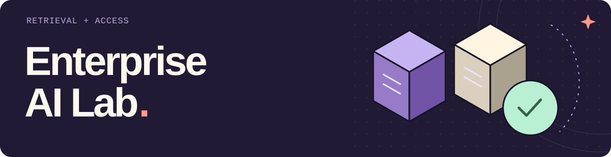
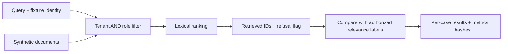

<picture>
  <source media="(max-width: 600px)" srcset="assets/readme-header-mobile.svg">
  
</picture>

A question should reach the right documents before it reaches a model. This lab
connects a real local OAuth issuer to dense vector retrieval, tenant/role filters
and cited answers. Public PDFs now enter through native extraction or actual
OCR, with page-level source spans and explicit permissions. A connected
publication path keeps proposed documents outside search until their exact
content and access policy receive a durable approval. The original
synthetic experiments remain available; HTTP, cryptography, embeddings and
persistence are real implementations.

The original lexical retrieval evaluator is still available below. It is a
separate controlled experiment, with its original reports preserved.

[PDF/OCR demo](#ingest-public-pdfs-and-scans) · [Identity → RAG design](docs/identity-rag.md) ·
[Recorded public run](reports/pdf-v1/demo.json) · [Connected synthetic demo](reports/rag-v1) ·
[Durable approval demo](#wait-for-approval-survive-a-restart) ·
[Approve → publish → query](#approve-a-document-before-it-enters-search) ·
[Browser review room](#open-the-source-and-leave-a-decision) ·
[Original retrieval study](docs/study-01.md) · [Roadmap](ROADMAP.md)

## Run the connected RAG demo

Use **Python 3.12+** (3.13 for the recorded run) and **Node.js 24**. The locked RAG
runtime is optional; the original evaluator keeps its dependency-free setup.
From this repository:

```sh
python3.13 -m venv .venv
.venv/bin/python -m pip install -r requirements-rag.lock
.venv/bin/python -m pip install --no-deps -e .

# Use a sibling checkout; skip cloning if it already exists.
git clone https://github.com/edsonsims/identity-boundary-lab ../identity-boundary-lab
(cd ../identity-boundary-lab && npm ci --ignore-scripts && npm run build)

# Explicit one-time download of pinned public embedding assets, about 91 MB.
.venv/bin/python -m enterprise_ai_lab.rag.models bootstrap --model-dir .local/models/minilm

.venv/bin/python -m enterprise_ai_lab.rag demo \
  --identity-dir ../identity-boundary-lab \
  --model-dir .local/models/minilm --store .local/rag-demo \
  --out reports/local/rag-demo.json
```

The command owns two separate local processes: Identity Boundary Lab's actual
`oidc-provider` issuer and this Python resource API. Tokens move through a private
child-process pipe and HTTP Authorization headers; they are not saved in reports.
The resource verifies the signature, issuer, **RAG audience**, expiry and scope
before constructing the vector filter from signed tenant/role claims.

Observed outcomes from the extractive demo:

| Request | Result |
| --- | --- |
| Alpha reader asks the processing limit | 200 · **20 documents** · cites `alpha-onboarding` |
| Alpha analyst asks the reserve buffer | 200 · **18 percent** · cites `alpha-reserve` |
| Alpha reader asks for the restricted reserve | 200 · abstains · no citations |
| Token requests another tenant, lacks the access role or lacks `rag:query` | 403 |
| Missing token or token for the reports audience | 401 |
| Caller tries to override tenant/roles in headers or JSON | 400 / 422 |
| Python resource restarts without re-seeding | Same persisted answer and cited content |

The store contains six authored documents split into eight chunks. Retrieval uses
**384-dimensional MiniLM ONNX embeddings and persistent Qdrant local mode**.
The Qdrant query applies `tenant AND any allowed role` before top-k; a second
payload check rejects unexpected results. No globally retrieved context is used
as a fallback.

The default answer step is an explicit **extractive baseline**, not a neural
language model. It copies a matching authorized sentence or abstains. The
[recorded output](reports/rag-v1/extractive.json) includes the complete responses.
Cosine scores may change slightly after restart; tests preserve exact IDs, text,
ACLs and answers with a `1e-6` score tolerance.

### Run actual local generation

The optional Qwen adapter performs real CPU generation from those same filtered
chunks. Install its recorded runtime and explicitly download the pinned public
checkpoint:

```sh
.venv/bin/python -m pip install -r requirements-generator.lock
.venv/bin/python -m enterprise_ai_lab.rag.neural bootstrap --cache-dir .local/models/qwen
```

That command prints a verified `model_dir`. Pass that path to a new demo run:

```sh
.venv/bin/python -m enterprise_ai_lab.rag demo \
  --identity-dir ../identity-boundary-lab --model-dir .local/models/minilm \
  --store .local/rag-qwen --out reports/local/rag-qwen.json \
  --generator qwen --generator-model-dir /path/printed/by/bootstrap
```

Model files stay outside Git. Serving loads verified local files and performs no
model download. A failed or malformed generation returns an error, with no silent
extractive fallback. Empty authorized context skips generation entirely.

Generated evidence must name an authorized retrieved chunk and quote it exactly.
That checks literal provenance, **not semantic faithfulness**. Answers still
require human review. Read the [actual neural observations](reports/rag-v1) and
[design limits](docs/identity-rag.md) before interpreting this small fixture.

### Exercise the integration boundaries

```sh
RUN_RAG_INTEGRATION=1 \
RAG_MODEL_DIR="$PWD/.local/models/minilm" \
IDENTITY_LAB_DIR="$PWD/../identity-boundary-lab" \
.venv/bin/python -m pytest tests/rag -q
```

These tests exercise actual issuer/resource HTTP, signatures, model embeddings,
vector filtering, role restrictions, expiry, issuer outage and store restart.
Other focused tests inject faults into real local persistence, verify admission
failures never call retrieval, and check malformed generated citations. They are
identified separately from actual model-generation observations.

Every local index mutation writes a pending marker first. A failed or interrupted
update makes the running process and a restarted process refuse that store,
until it is rebuilt from trusted source documents. That favors refusing an
incomplete permission update over serving stale access metadata.

[Protocol, HTTP errors and study exercises](docs/identity-rag.md) ·
[Model/fixture provenance](src/enterprise_ai_lab/rag/data/PROVENANCE.md)

## Ingest public PDFs and scans

The new demo uses two selected pages from public NIST publications. One is
native text; the other is a labelled image-only derivative that must pass through
**PDFium and Tesseract**. The unchanged originals, derivative, hashes, page mapping
and [source rights](public-data/pdf-v1/README.md) are checked in.

Use the connected setup above, **Tesseract 5 with English data**, and install
both compatible lockfiles together:

```sh
.venv/bin/python -m pip install -r requirements-rag.lock -r requirements-ingestion.lock

.venv/bin/python -m enterprise_ai_lab.rag pdf-demo \
  --manifest public-data/pdf-v1/ingestion.json \
  --identity-dir ../identity-boundary-lab \
  --model-dir .local/models/minilm --store .local/pdf-demo \
  --out reports/local/pdf-demo.json
```

Use a fresh store: the provenance-bearing index is **schema 2**, and old index
fingerprints are deliberately rejected. The [complete PDF guide](docs/pdf-ingestion.md)
also includes standalone setup and an `ingest` command without the HTTP demo.

| Material | Recorded origin | Authored local access |
| --- | --- | --- |
| *Zero Trust Architecture* | Original PDF page 15 · native text | Alpha reader; Beta reader |
| *AI RMF Core* | Raster page 1 → original PDF page 25 · actual OCR | Alpha analyst; Beta reader |

Ask **“How is access to individual enterprise resources granted?”** or
**“What functions is the Core composed of?”**. The demo uses actual issuer/resource HTTP,
signed tokens, MiniLM vectors and persisted Qdrant with the extractive answer
baseline. The [complete recorded responses](reports/pdf-v1/demo.json) keep the
permission controls and the sources behind each quoted answer.

The recorded generic question “What are the four functions?” abstains despite
the analyst's permitted source. That failure remains in the report: permission
filtering does not fix question wording or retrieval/answer relevance.

Each chunk carries the original URL, original and processed PDF hashes/pages,
extraction method, canonical page-text hash and exact character span. OCR adds
word spans, pixel boxes and uncalibrated confidence diagnostics. Tenant and role
grants come from the trusted local manifest; PDF metadata cannot grant access.
The same prefilter protects retrieval, generator context and citations.

Re-ingestion replaces that tenant/source/page's content and ACLs. It extracts
the whole incoming batch before writing; an incomplete index mutation refuses
reads and restart until rebuilt. Omitted pages **are not deletions**. There is no
public upload endpoint or live entitlement synchronization.

```sh
RUN_RAG_INTEGRATION=1 \
RAG_MODEL_DIR="$PWD/.local/models/minilm" \
IDENTITY_LAB_DIR="$PWD/../identity-boundary-lab" \
.venv/bin/python -m pytest tests/rag tests/ingestion -q
```

This is a two-page integration fixture, with one clean raster OCR page. It does
not establish OCR accuracy on damaged scans, handwriting, difficult layouts or
other languages. Native reading order and OCR text can lose layout; literal
citations still require interpretation and human review.

## Wait for approval, survive a restart

The next study adds a durable gate for one small action: publish a local note.
It uses actual **Temporal**, a verified OAuth reviewer identity and a separate
SQLite sink. The approval binds the exact note, tenant, requester and deadline.
A rejected or expired request cannot run the note activity.

The process demo restarts the persistent server and HTTP API, then kills a
worker after the note commits but before its acknowledgement. Recovery checks
that the matching local effect stays a single row. Captured histories also run
through the SDK Replayer. Approval and successful publication are separate states.

Use Python 3.12+, Node 24, and the [approval setup](docs/durable-approval.md),
including `requirements-approval.lock` and the explicit pinned CLI bootstrap:

```sh
.venv-approval/bin/python -m enterprise_ai_lab.approval demo \
  --temporal-cli .local/temporal-bin/temporal \
  --identity-dir ../identity-boundary-lab --node node \
  --work-dir .local/approval-demo \
  --out reports/local/approval-demo.json
```

The reviewer is a **scripted service identity**, not a logged-in person. The
notification is local; no external message is sent. The development Temporal
endpoint trusts local administrators, so HTTP authentication is not a production
security boundary for gRPC. Read the [protocol, tradeoffs and exercises](docs/durable-approval.md)
and [recorded process run](reports/approval-v1/demo.json).

## Approve a document before it enters search

The [connected publication demo](docs/approved-publication.md) joins those
studies: stage a public native/OCR page outside the index, request review, then
publish only after an independent OAuth reviewer accepts its immutable
snapshot. The approved content includes the tenant, roles, text and full source
provenance. RAG queries keep the existing tenant AND role prefilter and cited
extractive answer.

Use the pinned model and Temporal CLI from the setups above, **Tesseract 5 with
English data**, and all three compatible locks in one Python 3.12+ environment:

```sh
.venv/bin/python -m pip install \
  -r requirements-rag.lock -r requirements-ingestion.lock -r requirements-approval.lock

.venv/bin/python -m enterprise_ai_lab.publication demo \
  --temporal-cli .local/temporal-bin/temporal \
  --identity-dir ../identity-boundary-lab --node node \
  --model-dir .local/models/minilm \
  --manifest public-data/pdf-v1/ingestion.json \
  --work-dir .local/publication-demo \
  --out reports/local/publication-demo.json
```

Pending, rejected and expired candidates remain outside search. A replacement
waits for its own approval while the previously approved content stays live.
Revision checks reject stale publications; an exact activity redelivery returns
the saved effect without restoring an older document or ACL. A pending journal
blocks reads while an exact retry can finish a recognized write gap. A partial
vector mutation keeps its original marker and requires a fresh store rebuild.

The [recorded process evidence](reports/publication-v1) distinguishes actual
OAuth, Temporal, native extraction/OCR, embeddings and persisted vectors from
controlled failures and authored policy. The reviewer remains a **scripted
service identity**, not a person's review. This gate applies to the connected
publication resource; the standalone trusted `rag ingest` study still has its
own direct operator path. That recorded service-identity study keeps its original
scope. The browser review extension below adds local user sign-in; production administration and
live permission synchronization remain future work.

## Open the source and leave a decision

The [review room](docs/human-review.md) adds a real local browser login and a
place to compare permitted PDF pages with their extracted words, chunk spans
and access rules. A reviewer can approve or reject the exact snapshot; the UI
then shows durable acceptance and completed RAG publication separately.

The account's tenant and roles protect the queue, text, PDF previews and audit.
An approver who can read the native page but lacks the OCR page's analyst grant
cannot decide the mixed batch. The independent analyst reviewer can inspect
both. Previews contain **one permitted page**, including an original-page view
for comparison with the OCR derivative.

Use the combined Python/Node/Tesseract setup above and the pinned browser issuer
from the [complete guide](docs/human-review.md):

```sh
.venv/bin/python -m enterprise_ai_lab.review demo \
  --temporal-cli .local/temporal-bin/temporal \
  --identity-dir ../identity-boundary-lab --node node \
  --model-dir .local/models/minilm \
  --manifest public-data/pdf-v1/ingestion.json \
  --work-dir .local/review-demo \
  --out reports/local/review-demo.json
```

For a rendered Chromium check, explicitly run `npm ci --ignore-scripts` and
`npx playwright install chromium`, then add `--browser-test` with a fresh work
directory. Add `--stay-open` to leave the interface running for manual use;
the local command prints its URL and the private generated account-file path.
Do not publish that file or reuse a real password.

The portal uses Code + PKCE and short-lived user tokens stored in server memory,
behind an opaque HttpOnly browser cookie. It checks CSRF and origin on decisions.
The local audit links intents to durable receipts and observed publication;
portal restart requires login again but preserves workflow/audit state.
[Design and exercises](docs/human-review.md) · [Run evidence](reports/review-v1) ·
[Browser protocol](tests/review/browser-protocol.md)

Automated fixture logins and clicks are **not a person's review or owner study**.
The audit is local, not externally tamper-proof, and the development Temporal
administration endpoint remains trusted. External SSO, production HTTPS, key
rotation and live entitlement synchronization remain planned.

## Run the first experiment

Python **3.10+**, with no runtime dependencies, credentials, model download or API
calls. From the repository root, on macOS/Linux:

```sh
python3 -m venv .venv
.venv/bin/python -m pip install -e .
.venv/bin/python -m enterprise_ai_lab demo --output reports/local/readme-demo --seed 42 --k 3
```

Actual CLI output:

```json
{"output": "reports/local/readme-demo", "safe_query_leakage": 0.0, "unsafe_query_leakage": 0.9}
```

The experiment creates **50 synthetic documents and 100 queries**, runs the same
lexical ranker under both policies, and writes complete result bundles:

```text
reports/local/readme-demo/
├── report.json
├── documents.jsonl
├── cases.jsonl
├── predictions.jsonl
├── results.jsonl
├── manifest.json
└── unsafe_global_baseline/
    └── ...the same bundle structure
```

The manifest records file hashes. The committed [filtered report](reports/reference/report.json),
[unsafe report](reports/reference/unsafe_global_baseline/report.json) and
[per-case evidence](reports/reference/results.jsonl) use the same seed and `k`.

## Read the result, including the failure

| Measured property · synthetic fixture | Tenant/role prefilter | Unsafe global ranker |
| --- | ---: | ---: |
| Queries returning unauthorized IDs | 0 / 100 | 90 / 100 |
| Answerable queries with a relevant result | 50 / 50 | 50 / 50 |
| Correct refusals on unanswerable queries | 40 / 50 | 10 / 50 |

The filtered system still fails to refuse **10 unanswerable queries**. Those
queries share words with permitted documents that do not answer the question.
Permission and relevance are separate checks; returning an allowed document
does not establish that it is useful evidence.



The evaluator checks retrieval hit rate, macro recall, query/document leakage and
abstention. It rejects missing or duplicate cases, unknown document IDs, invalid
relevance labels, nonfinite scores and malformed predictions. Empty retrieval
has an explicit representation and denominator.

## Bring another retriever's predictions

Use the included JSONL example files to exercise the replay interface:

```sh
.venv/bin/python -m enterprise_ai_lab evaluate \
  --documents examples/documents.jsonl \
  --cases examples/cases.jsonl \
  --predictions examples/predictions.jsonl \
  --output reports/local/readme-replay
```

Replace only the predictions file with another system's output, following the
[data contract](docs/data-contract.md). Keep source documents, case IDs and
relevance labels fixed when comparing systems. Do not commit private inputs or
outputs.

## Continue the sequence

| Study | Runnable companion | Boundary to examine |
| --- | --- | --- |
| 2 · Discovery to scope | [BriefTrace](https://github.com/edsonsims/brieftrace#run-the-story): Python compiler, exact source spans, SQLite revisions and a local HTTP API | Missing facts stay questions; proposed criteria require review. No model extraction or commercial approval is implied. |
| 3 · Identity and authorization | [Identity Boundary Lab](https://github.com/edsonsims/identity-boundary-lab#run-the-experiment): TypeScript, actual OAuth issuer, JWT verification and opaque-token introspection | Compare revocation, issuer availability and tenant/role checks. A separate local Code + PKCE issuer now supplies browser review accounts; external SSO, SAML and SCIM remain planned. |

Identity Boundary Lab now supplies the issuer for the connected RAG experiment
above. BriefTrace remains a separate discovery/compiler study. Each repository
keeps its own setup, demo, tests and design decisions.

## Test and study it

```sh
.venv/bin/python -m unittest discover -s tests -v
```

The [first study](docs/study-01.md) records the hypothesis, fixture categories,
metric definitions, verification and exercises. Try changing `k`, explain one
failure from the JSONL, or build a counterexample to the refusal heuristic.
Owner study and human review remain unclaimed until recorded.

## What these numbers establish

The original lexical study is a controlled engineering experiment with repeated
synthetic templates. Its scores do not establish production security, model accuracy, generalization,
compliance or customer ROI. The Wilson values in JSON are descriptive binomial
calculations; the correlated templates do not support population confidence claims.

In the original lexical experiment, identities and ACLs remain trusted fixture
inputs. The connected RAG study above adds actual token validation, dense-vector
retrieval and an optional local generator as a separate path. The PDF/OCR path
adds real public sources and source spans; live entitlement synchronization and
enterprise-system connectors remain future work. The unsafe
global baseline is confined to the offline evaluator.

Security filtering is an established pattern. Microsoft's
[security trimming documentation](https://learn.microsoft.com/en-us/azure/search/search-security-trimming-for-azure-search)
describes principal-based filtering and its distinction from authentication.
This repository studies that boundary and claims no new retrieval method.

[Roadmap](ROADMAP.md) · [Contribution guide](CONTRIBUTING.md) ·
[AI assistance](AI_ASSISTANCE.md) · [MIT license](LICENSE)
