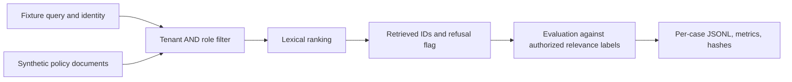

# Enterprise AI Lab

[](https://github.com/edsonsims/enterprise-ai-lab/actions/workflows/ci.yml)

Replayable experiments in access control, retrieval evaluation, and reliable AI
systems. This is a growing engineering study portfolio, with executable baselines,
failure cases, and explicit limits.

**Available now:** an offline retrieval evaluation harness and a tenant/role
filtering experiment. The remaining [15-study roadmap](ROADMAP.md) is planned work.
The initial implementation is [AI-assisted](AI_ASSISTANCE.md); personal study and
human review are not inferred from automated checks.

## Run the first study

Python 3.10 or later; no runtime dependencies, credentials, model download, API
calls, or cloud account. The setup commands below use a macOS/Linux shell.

```sh
git clone https://github.com/edsonsims/enterprise-ai-lab.git
cd enterprise-ai-lab
python3 -m venv .venv
. .venv/bin/activate
python -m pip install -e .
python -m unittest discover -s tests -v
python -m enterprise_ai_lab demo --output reports/local/demo --seed 42
```

Open `reports/local/demo/report.json` and its `unsafe_global_baseline/report.json`.
Each bundle includes the input documents, query cases, predictions, per-case
results, metric definitions, and a SHA-256 manifest. The committed
[reference run](reports/reference/report.json) is generated with seed 42 and `k=3`.
See the [first study](docs/study-01.md) for measured results and a learning exercise.

## What the experiment measures

The fixture contains synthetic policy documents shared across fictional tenants.
A lexical ranker is run with two policies: filter by tenant and role before scoring,
or deliberately ignore permissions as an unsafe comparison. This isolates the
retrieval boundary from model behavior and makes each result inspectable.



The evaluator measures retrieval hit rate, macro recall, query/document leakage,
and abstention behavior. It rejects missing or duplicate cases, unknown documents,
invalid relevance labels, and malformed predictions. Empty results are represented
explicitly so that returning nothing cannot masquerade as useful retrieval.

You can also replay predictions produced by another retrieval system:

```sh
python -m enterprise_ai_lab evaluate \
  --documents examples/documents.jsonl \
  --cases examples/cases.jsonl \
  --predictions examples/predictions.jsonl \
  --output reports/local/replay
```

The [data contract](docs/data-contract.md) defines the JSONL fields and denominators.
Do not commit private input data or evaluation outputs containing it.

## Interpretation and limits

This is a controlled engineering experiment with repeated synthetic templates.
Good fixture results do not establish production security, model accuracy,
independent statistical generalization, compliance, or customer ROI. In particular,
permission filtering does not determine whether an allowed document actually
answers a question. The study includes a counterexample for this distinction.

Identities and ACLs are trusted fixture inputs. Authentication, fresh permission
synchronization, vector search, answer generation, OCR, and live enterprise systems
are future integrations. The unsafe baseline is intentionally vulnerable and is
only for the offline lab. No public service is started.

Document security filtering is an established pattern. Microsoft's
[security trimming documentation](https://learn.microsoft.com/en-us/azure/search/search-security-trimming-for-azure-search)
describes filtering by principal metadata and distinguishes it from authentication.
This repository studies that boundary and makes no novelty claim.

## Explore and contribute

- [Roadmap and completion criteria](ROADMAP.md)
- [Design decisions](docs/decision-log.md)
- [First study and owner exercises](docs/study-01.md)
- [Contribution guide](CONTRIBUTING.md)
- [AI assistance and evidence boundaries](AI_ASSISTANCE.md)

MIT licensed. Maintained by [Edson Henrique](https://github.com/edsonsims).
