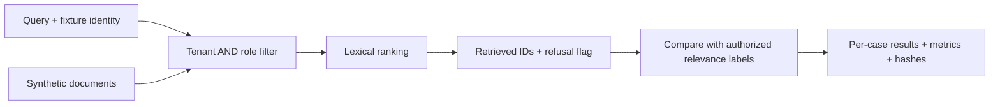

<picture>
  <source media="(max-width: 600px)" srcset="assets/readme-header-mobile.svg">
  
</picture>

Can a retrieval system return useful context while respecting tenant and role
boundaries? This lab compares a permission prefilter with an intentionally unsafe
global ranker, then measures both against the same **synthetic** cases.

**Available here:** the offline retrieval evaluator and first access-control study.
[BriefTrace](https://github.com/edsonsims/brieftrace) and
[Identity Boundary Lab](https://github.com/edsonsims/identity-boundary-lab) continue
the sequence as standalone projects. The [roadmap](ROADMAP.md) separates each
implemented milestone from its remaining integrations.

[Study & counterexample](docs/study-01.md) · [Data contract](docs/data-contract.md) ·
[Design decisions](docs/decision-log.md) · [Assistance & ownership](AI_ASSISTANCE.md)

## Run the first experiment

Python **3.10+**, with no runtime dependencies, credentials, model download or API
calls. From the repository root, on macOS/Linux:

```sh
python3 -m venv .venv
.venv/bin/python -m pip install -e .
.venv/bin/python -m enterprise_ai_lab demo --output reports/local/readme-demo --seed 42 --k 3
```

Actual CLI output:

```json
{"output": "reports/local/readme-demo", "safe_query_leakage": 0.0, "unsafe_query_leakage": 0.9}
```

The experiment creates **50 synthetic documents and 100 queries**, runs the same
lexical ranker under both policies, and writes complete result bundles:

```text
reports/local/readme-demo/
├── report.json
├── documents.jsonl
├── cases.jsonl
├── predictions.jsonl
├── results.jsonl
├── manifest.json
└── unsafe_global_baseline/
    └── ...the same bundle structure
```

The manifest records file hashes. The committed [filtered report](reports/reference/report.json),
[unsafe report](reports/reference/unsafe_global_baseline/report.json) and
[per-case evidence](reports/reference/results.jsonl) use the same seed and `k`.

## Read the result, including the failure

| Measured property · synthetic fixture | Tenant/role prefilter | Unsafe global ranker |
| --- | ---: | ---: |
| Queries returning unauthorized IDs | 0 / 100 | 90 / 100 |
| Answerable queries with a relevant result | 50 / 50 | 50 / 50 |
| Correct refusals on unanswerable queries | 40 / 50 | 10 / 50 |

The filtered system still fails to refuse **10 unanswerable queries**. Those
queries share words with permitted documents that do not answer the question.
Permission and relevance are separate checks; returning an allowed document
does not establish that it is useful evidence.



The evaluator checks retrieval hit rate, macro recall, query/document leakage and
abstention. It rejects missing or duplicate cases, unknown document IDs, invalid
relevance labels, nonfinite scores and malformed predictions. Empty retrieval
has an explicit representation and denominator.

## Bring another retriever's predictions

Use the included JSONL example files to exercise the replay interface:

```sh
.venv/bin/python -m enterprise_ai_lab evaluate \
  --documents examples/documents.jsonl \
  --cases examples/cases.jsonl \
  --predictions examples/predictions.jsonl \
  --output reports/local/readme-replay
```

Replace only the predictions file with another system's output, following the
[data contract](docs/data-contract.md). Keep source documents, case IDs and
relevance labels fixed when comparing systems. Do not commit private inputs or
outputs.

## Continue the sequence

| Study | Runnable companion | Boundary to examine |
| --- | --- | --- |
| 2 · Discovery to scope | [BriefTrace](https://github.com/edsonsims/brieftrace#run-the-story): Python compiler, exact source spans, SQLite revisions and a local HTTP API | Missing facts stay questions; proposed criteria require review. No model extraction or commercial approval is implied. |
| 3 · Identity and authorization | [Identity Boundary Lab](https://github.com/edsonsims/identity-boundary-lab#run-the-experiment): TypeScript, actual OAuth issuer, JWT verification and opaque-token introspection | Compare revocation, issuer availability and tenant/role checks. Browser SSO, SAML and SCIM remain planned. |

Each repository includes its own setup, executable demo, HTTP examples, tests and
design decisions. They are separate local experiments; they are not yet wired
into this retrieval pipeline.

## Test and study it

```sh
.venv/bin/python -m unittest discover -s tests -v
```

The [first study](docs/study-01.md) records the hypothesis, fixture categories,
metric definitions, verification and exercises. Try changing `k`, explain one
failure from the JSONL, or build a counterexample to the refusal heuristic.
Owner study and human review remain unclaimed until recorded.

## What these numbers establish

This is a controlled engineering experiment with repeated synthetic templates.
Its scores do not establish production security, model accuracy, generalization,
compliance or customer ROI. The Wilson values in JSON are descriptive binomial
calculations; the correlated templates do not support population confidence claims.

Identities and ACLs are trusted fixture inputs. Authentication, permission
synchronization, vector search, generated answers, OCR and live enterprise
systems are future integrations. The unsafe baseline is only for this offline
lab; no public service is started.

Security filtering is an established pattern. Microsoft's
[security trimming documentation](https://learn.microsoft.com/en-us/azure/search/search-security-trimming-for-azure-search)
describes principal-based filtering and its distinction from authentication.
This repository studies that boundary and claims no new retrieval method.

[Roadmap](ROADMAP.md) · [Contribution guide](CONTRIBUTING.md) ·
[AI assistance](AI_ASSISTANCE.md) · [MIT license](LICENSE)
