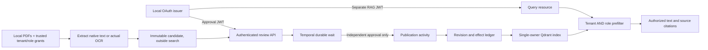

# Approve a document before it becomes RAG context

The connected publication resource joins the existing PDF/OCR, identity and
Temporal studies. A trusted local operator extracts a candidate without putting
it in the searchable index. A requester submits that immutable candidate for
review. Only an independent, authenticated approval can schedule publication.
The default answer step remains the extractive baseline; no model approves a
document or chooses its permissions.

The demo reviewer is a **scripted OAuth service identity**, not a person who
signed in, read a document or completed a study. This is a local integration
experiment, not a production document-management system.

## Run the connected demo

Use **Python 3.12+**, **Node.js 24**, and **Tesseract 5 with English data** on
macOS arm64 or Linux amd64. Install all three compatible runtime locks together:

```sh
python3.13 -m venv .venv-publication
.venv-publication/bin/python -m pip install \
  -r requirements-rag.lock -r requirements-ingestion.lock -r requirements-approval.lock
.venv-publication/bin/python -m pip install --no-deps -e .

# Use a sibling checkout; skip cloning if it already exists.
git clone https://github.com/edsonsims/identity-boundary-lab ../identity-boundary-lab
(cd ../identity-boundary-lab && npm ci --ignore-scripts && npm run build)

# Explicit one-time downloads; serving and ingestion do not download assets.
.venv-publication/bin/python -m enterprise_ai_lab.rag.models bootstrap \
  --model-dir .local/models/minilm
.venv-publication/bin/python -m enterprise_ai_lab.approval.bootstrap bootstrap \
  --directory .local/temporal-bin

.venv-publication/bin/python -m enterprise_ai_lab.publication demo \
  --temporal-cli .local/temporal-bin/temporal \
  --identity-dir ../identity-boundary-lab --node node \
  --model-dir .local/models/minilm \
  --manifest public-data/pdf-v1/ingestion.json \
  --work-dir .local/publication-demo \
  --out reports/local/publication-demo.json
```

Use a fresh work directory for an independent run. Supply the absolute Node 24
executable path if `node` resolves to another version. The embedding model and
Temporal executable use the existing pinned hashes; no model or CLI download
occurs while the resource serves requests. Tesseract is a separate installed
system dependency. The setup does not provision cloud infrastructure or call
paid APIs.

The retained run and CI use Identity Boundary Lab commit
`26215ef9cdf01162b168d4031c7929400ee4c96c`. Keep an existing checkout's changes;
use a separate checkout of that revision when reproducing the pinned run.

Run the complete suite with the actual integrations enabled:

```sh
RUN_RAG_INTEGRATION=1 RUN_APPROVAL_INTEGRATION=1 RUN_PUBLICATION_INTEGRATION=1 \
TEMPORAL_CLI="$PWD/.local/temporal-bin/temporal" \
RAG_MODEL_DIR="$PWD/.local/models/minilm" \
IDENTITY_LAB_DIR="$PWD/../identity-boundary-lab" NODE_BINARY=node \
.venv-publication/bin/python -m pytest tests -q
```

The opt-in flags require the declared local runtimes; missing dependencies fail
the enabled integration rather than silently skipping it. Tests without these
flags retain explicit skips for the real-process/model paths.

The [recorded run](../reports/publication-v1) retains the actual observations and
reproduction details. The older [PDF/OCR report](../reports/pdf-v1) and
[local-note approval report](../reports/approval-v1) remain separate, unchanged
experiments.

## Where the gate applies



The **connected publication resource** owns its Qdrant directory and ledger. It
does not expose the standalone ingestion or ACL-mutation methods over HTTP.
Staging, requesting review, approving and publishing are distinct operations.
Pending, rejected and expired candidates do not become search context.

The older `enterprise_ai_lab.rag ingest` command is still a trusted local
operator tool for the standalone PDF study. It does **not** implement this
approval gate. Running that separate deployment, editing local files, or using
the development Temporal administration endpoint is outside this resource's
authenticated boundary. Do not describe the gate as protection against a
host administrator.

## What the approval fixes

The immutable candidate binds the exact document text, title, document ID,
tenant, allowed roles and complete source provenance. Its content hash is part
of the workflow snapshot together with the requester, request ID, deadline,
publication action and expected current revision. A changed ACL, source-page
mapping, OCR word box or text creates different reviewed content.

Identity comes from the verified dedicated approval JWT. A request body cannot
choose the authenticated tenant, requester or reviewer roles. A reviewer needs
the approval decision scope and approver role and must differ from the
requester. The RAG query endpoint separately requires the RAG audience, query
scope and a reader or analyst role. Being a reviewer does not itself grant
document-reading access.

The deadline limits **decision acceptance**. Once a valid approval has been
accepted, its retried publication may finish after that deadline. Rejected and
expired requests never authorize a publication activity. Approval is not a
promise that publication succeeded: the status and effect receipt record that
separately.

The review API returns the candidate hash and bounded document/source summaries,
without full text or OCR word boxes. The trusted local candidate repository
retains the complete reviewed bytes. A human document viewer and attestation
flow are not implemented; the scripted demo accepts the fixed candidate hash.

## Keep published revisions stable

A proposed replacement names the current **tenant corpus revision** it expects.
This deliberately serializes even otherwise unrelated concurrent batches in one
tenant; another tenant has an independent revision. A batch replaces only its
named document IDs, retaining omitted previously approved pages. The publication
activity compares that expectation with the ledger while holding the same
owner lock used for reads and writes. A competing stale approval conflicts
instead of overwriting a more recent document or restoring an older ACL.
Existing approved content remains searchable while a replacement waits for its
own approval.

Temporal can deliver an activity again after its effect commits but before its
acknowledgement reaches the server. The activity checks its unique effect key
and the complete saved request and decision receipt **before** checking the
revision. An exact replay returns its original effect receipt; it does not
reindex an older approved document over a newer revision. Altered content or a
different receipt under that key conflicts.

This is tested idempotency for a bounded local effect. It is not a transaction
across Temporal, SQLite and Qdrant, nor a guarantee of exactly-once external
actions.

## Refuse partial publication

One process owns Qdrant local mode. Query handling and publication share its
lock, avoiding a second process opening the same embedded store. A query
does not wait for a busy publisher: the query resource returns a
sanitized 503 so a caller retries explicitly with a freshly checked token.
A durable SQLite pending journal fences reads before the vector mutation and remains
pending until the publication ledger commits. The existing vector store's
`rag-write-pending` marker also remains in force.

Validate the complete incoming batch and compute **all embeddings before the
pending journal begins**. A candidate can satisfy the character limit yet exceed
the embedding tokenizer's limit. That preparation failure rejects publication
without fencing or replacing previously approved content. The prepared vectors
are applied once under the same owner lock; serving never silently truncates
the candidate to make it fit.

If publication stops with a pending journal, queries refuse the deployment until
that exact operation finishes. A restarted resource can run the recovery
activity while keeping reads fenced. Its activity may resume only
when the vector inventory is exactly the previous committed view or the complete
approved next view and the vector mutation marker is absent. A partial vector
write, an unexpected inventory, or `rag-write-pending` prevents that recovery.
Ownership metadata binds the ledger and index at startup. Every query also
checks that vector payloads match the committed document inventory.
A missing/replaced ledger or untracked vector content must not silently become
an approved corpus.

Recovery from a partial or unexplained mutation builds a **fresh ledger and
index from trusted approved inputs**. Deleting a pending journal or vector marker
to resume serving is not recovery.
This deliberately trades availability for refusing ambiguous content and ACLs.
It does not claim power-loss durability, distributed transactions, or automatic
recovery from every storage failure.

## Preserve the source and access policy

The public demo reuses the unchanged NIST originals and the labelled clean raster
derivative from [the PDF study](pdf-ingestion.md). Its two unique English pages
have four authored tenant/page grants:

| Selected public page | Extraction | Local grants |
| --- | --- | --- |
| *Zero Trust Architecture*, original physical page 15 | Native text | Alpha reader; Beta reader |
| *AI RMF Core*, artifact page 1 → original physical page 25 | Actual PDFium → Tesseract OCR | Alpha analyst; Beta reader |

Original publication URL, original/artifact hashes and physical pages,
extraction method, complete canonical page-text hash, exact Unicode spans and
OCR word geometry survive candidate creation, approval, publication and the
returned citation. The trusted operator's page mapping is an assertion with a
recorded build procedure, not something OCR can prove.

Publication preserves the approved tenant and allowed roles. Retrieval still
requires `tenant AND any allowed role` **before vector top-k**, followed by
payload revalidation. The answer and citation receive only that permitted
context. The same public source can therefore be readable under different roles
in different tenants without sharing their local approval or revision state.

Public sources retain their [own rights and derivative notice](../public-data/pdf-v1/README.md).
No NIST endorsement is claimed. Exact quotations establish a source location;
they do not establish semantic answer quality or OCR correctness.

## Inspect the evidence and failure cases

The connected integration checks pending, rejected and expired candidates,
independent review, changed snapshots, tenant/role restrictions, revision
conflicts, publication redelivery, persistent process restart and replayed
workflow histories. Inventory checks distinguish “not indexed” from “indexed
but irrelevant to this question.” Controlled failures and authored policy are
identified separately from actual OAuth, Temporal, OCR, ONNX and Qdrant calls.

The report contains selected public text and provenance. Complete candidate
text lives in the local candidate repository and committed document inventory;
the workflow stores the bound candidate hash, request and decision rather than
the complete document. Private candidate storage and reports still need a
retention and access policy; these public files are not an appropriate report
template for private tenant documents. Retention,
history encryption, production identity/key lifecycle, live entitlement
synchronization, human review UI and a hostile-upload sandbox remain future
work. Offline JWT roles remain valid until token expiry, and already returned
text cannot be withdrawn.

Study exercises:

1. Trace one OCR word from the candidate hash to an approved citation.
2. Submit two replacements for the same expected revision and inspect the stale
   approval's publication result.
3. Retry an older completed effect after a newer ACL revision and verify the
   current ACL remains unchanged.
4. Explain why a failed partial publication requires a fresh store rather than
   deleting a marker.
5. Separate the scripted review receipt from evidence that a person understood
   and approved the document.

Owner study and human review have not been reported.
