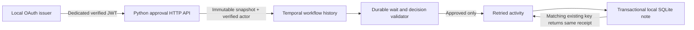

# A durable approval, with a local effect

An approval should refer to the exact action the reviewer saw. A worker restart
should not erase the wait, and a lost acknowledgement should not repeat the
approved action. This study uses actual Temporal Workflows and a local SQLite
notification sink to examine those boundaries.

The action is deliberately small: **publish one local note**. It does not send
email, Slack messages, payments or requests to an external system. The reviewer
in the demo is a scripted OAuth service identity, not a person who logged in or
reviewed the note. No neural model decides whether to approve it.

## Run the actual process demo

Use **Python 3.12+**, **Node.js 24**, and either **macOS arm64 or Linux amd64**.
The exact approval runtime is separate from the optional RAG/OCR dependencies.
From the repository root:

```sh
python3.12 -m venv .venv-approval
.venv-approval/bin/python -m pip install -r requirements-approval.lock
.venv-approval/bin/python -m pip install --no-deps -e .

# Use a sibling checkout; skip cloning if it already exists.
git clone https://github.com/edsonsims/identity-boundary-lab ../identity-boundary-lab
(cd ../identity-boundary-lab && npm ci --ignore-scripts && npm run build)

# Explicit one-time download of the pinned official CLI, about 45 MB.
.venv-approval/bin/python -m enterprise_ai_lab.approval.bootstrap bootstrap \
  --directory .local/temporal-bin

.venv-approval/bin/python -m enterprise_ai_lab.approval demo \
  --temporal-cli .local/temporal-bin/temporal \
  --identity-dir ../identity-boundary-lab --node node \
  --work-dir .local/approval-demo \
  --out reports/local/approval-demo.json
```

An existing Identity Boundary Lab checkout needs the approval audience and
profiles from this milestone; preserve local edits when updating it. `node` must
resolve to Node 24, or supply that executable's absolute path. The command owns
its local processes and persists its Temporal and notification databases under
the work directory. Use a fresh work directory for a new independent demo run.

Only `bootstrap` downloads anything. It fetches the official Temporal CLI
**1.9.1**, which embeds server **1.32.0**, and verifies both archive and executable
hashes from the [checked-in lock](../src/enterprise_ai_lab/approval/temporal-cli-lock.json).
Existing changed files are refused. The bootstrap does not install a global
executable. Worker and demo startup require local artifacts; neither invokes
the SDK's automatic server download.

Offline artifact verification is also available:

```sh
.venv-approval/bin/python -m enterprise_ai_lab.approval.bootstrap verify \
  --temporal-cli .local/temporal-bin/temporal
```

The CLI/server versions are pinned experimental dependencies, not a claim about
the newest releases. See the [official CLI release](https://github.com/temporalio/cli/releases/tag/v1.9.1)
and [Python SDK message handlers](https://github.com/temporalio/documentation/blob/main/docs/develop/python/workflows/message-passing.mdx).

## What survives a restart



The process demo exercises an actual native Temporal development server with
persistent SQLite, a separate Python worker, the OAuth issuer and a separate
HTTP API. It stops and restarts processes, kills a worker **after the local
SQLite commit and before the activity acknowledgement**, then observes recovery
against the preserved databases. It also feeds captured histories to the real
SDK Replayer. Controlled fault hooks are trusted worker configuration, not
options accepted from API requests.

Restart and replay are different checks. Restart asks whether a running system
recovers its durable state; replay asks whether the workflow code can consume
the recorded history without nondeterminism. Neither proves that a future code
version will replay old histories. Workflow versioning and migration remain
planned.

The [recorded demo](../reports/approval-v1/demo.json) keeps per-case responses,
process/recovery observations and limitations. Its notes and accounts are
authored public fixtures. Original lexical, synthetic RAG, Qwen and public PDF
reports remain separate and unchanged.

## The request is an immutable snapshot

A request contains:

- A tenant-scoped `request_id` and the verified requester's `requested_by` ID.
- A fixed `publish_local_note` action with a title and body.
- A canonical UTC `expires_at`, with a new request's deadline within 24 hours.
- A server-computed `snapshot_sha256` covering the schema, action, request ID,
  tenant, requester, full payload and deadline.

The API accepts note content and the deadline, then derives the tenant and
requester from the verified JWT. The caller cannot select another requester,
roles, action, destination, filesystem path or precomputed request digest.
Changing the note or deadline requires a different request ID. An identical
create retry returns the existing request, including after it has become
terminal. A changed create under the same ID conflicts.

Decisions include a `command_id`, the snapshot digest and `approve` or `reject`.
The gateway supplies the actor ID, tenant and roles from the verified JWT; it
does not accept them in JSON. An independent actor with the `approver` role is
required. A requester who also has that role cannot approve their own request.

Workflow Update validators check the same tenant, snapshot, role, independence
and deadline before accepting a decision. The workflow's clock, rather than a
caller-supplied decision timestamp, determines expiry. Once a decision is
accepted, an exact command retry returns its original receipt. Another actor,
decision or command under that terminal request conflicts.

Temporal deduplicates an Update ID before calling a validator. The gateway
therefore derives that ID from the **whole verified command**, and checks that
the returned receipt contains exactly that command. The real-server regression
demonstrates why using only a caller's `command_id` is insufficient.

## Approval is separate from publication

| Workflow state | Meaning for the local note |
| --- | --- |
| `pending` | No accepted decision; no note activity runs. |
| `approved` + publication `pending` | Approval is durable; the activity has not yet returned a successful receipt. |
| `approved` + publication `published` | The local sink's matching committed row was acknowledged. |
| `approved` + publication `failed` | Activity retries exhausted or failed; approval alone is not publication evidence. |
| `rejected` | Terminal decision; the note activity does not run. |
| `expired` | Deadline passed without an accepted decision; the note activity does not run. |

An approval accepted before expiry may complete its activity after expiry. The
deadline limits **decision acceptance**, not completion of an already approved
action. The timer, accepted decision and activity progression are recorded in
Temporal history. The local activity has bounded retry/time budgets; persistent
failures remain failures instead of silently appearing published.

The sink uses a transaction and a unique key derived from tenant and request
ID. It stores the note, snapshot hash and complete decision receipt together.
On a duplicate delivery it compares every immutable field before returning the
same effect receipt. Changed content under the key is an error. There is no
transaction spanning Temporal and this database: the commit-before-acknowledgement
gap remains, and the unique record handles that gap for this one local effect.
This is not a guarantee of exactly-once external messaging.

## HTTP boundary

The approval resource uses its own audience, `urn:identity-boundary:approval`,
and scopes `approval:request`, `approval:read` and `approval:decide`. RAG and
reports tokens do not grant approval authority. Demo profiles include
`requester-alpha`, `requester-beta`, `approver-alpha`, `approver-beta` and
`dual-alpha`; they are local client-credentials identities. The dual-role profile
exists to test rejection of self-approval.

| Operation | Route | Required scope and role |
| --- | --- | --- |
| Create | `POST /v1/tenants/{tenant}/approvals` | `approval:request` + `requester` |
| Read state | `GET /v1/tenants/{tenant}/approvals/{request_id}` | `approval:read` + `requester` or `approver` |
| Decide | `POST /v1/tenants/{tenant}/approvals/{request_id}/decisions` | `approval:decide` + `approver` |

For example, the create JSON is:

```json
{
  "request_id": "note-001",
  "note": {
    "title": "Research summary",
    "body": "An authored local demonstration note."
  },
  "expires_at": "2026-10-18T15:00:00Z"
}
```

Replace the example deadline with a future UTC time. Copy the returned snapshot
digest into the decision body:

```json
{
  "command_id": "review-001",
  "snapshot_sha256": "<exact digest from the request snapshot>",
  "decision": "approve"
}
```

This second example shows the field shape; the placeholder is not a valid
digest. There are no saved bearer tokens in these examples, workflow history,
notification rows or public reports.

Wrong or missing tokens return 401. A tenant, scope or role mismatch returns
403; unknown requests return 404; stale hashes, expiry and conflicting retries
return 409. Bounded malformed requests return 400/422. Capacity, worker or server
unavailability returns 503. A timeout can happen after a durable operation has
already been accepted: read status and retry with the **same immutable request
and command IDs**, rather than creating a new action.

Run `python -m enterprise_ai_lab.approval worker --help` and `serve --help` for
the separate process commands. Both connect only to an explicit literal loopback
Temporal address. The demo starts that server itself from the verified local
CLI; it does not connect to a cloud account.

## Trust and retention limits

- The unauthenticated local Temporal gRPC endpoint is a **trusted developer/admin
  boundary**. Someone who can call it or alter worker code can supply fabricated
  actor values. JWT checks on the HTTP API do not secure gRPC. Do not expose this
  development server or claim a production approval system.
- The issuer uses short-lived offline JWTs and startup JWKS, as in the connected
  RAG study. Browser sign-in, a human reviewer UI, live entitlement synchronization,
  key rotation and durable issuer accounts remain planned.
- Histories and the sink contain note text and identities. Use synthetic/public
  inputs for this demo. Token omission does not make those records non-sensitive.
  This milestone does not implement encryption, data-erasure workflows or a
  private-document publication policy.
- Idempotency relies on preserved namespace history and sink records. Temporal
  retention, database deletion/restoration and future request-ID reuse need an
  explicit lifecycle policy. The local sink can reject a changed surviving key,
  but no indefinite cross-system deduplication guarantee is claimed.
- The study does not automatically approve or publish RAG answers. It establishes
  a separately runnable approval boundary; binding a reviewed RAG artifact to its
  source revisions is a later integration.

## Test and study

```sh
TEMPORAL_CLI="$PWD/.local/temporal-bin/temporal" \
RUN_APPROVAL_INTEGRATION=1 \
IDENTITY_LAB_DIR="$PWD/../identity-boundary-lab" \
NODE_BINARY=node \
.venv-approval/bin/python -m pytest tests/approval -q
```

Core tests use actual Temporal Updates, timers, retries and history replay.
Controlled unit fixtures separately exercise canonical hashes, malformed
decisions, local sink collisions and bootstrap extraction/download failures.
The process demo supplies the restart and worker-kill evidence. A passing test
is automated evidence, not an owner's human approval or completed study.

Try these exercises:

1. Explain why changing a deadline changes the snapshot hash.
2. Retry a decision after a simulated lost HTTP response. Show the same receipt
   and one local note, then change the command and explain the conflict.
3. Kill a worker after the sink commit. Identify the committed row, pending
   activity and retry in the preserved history.
4. Separate a requester's role, a reviewer's authorization and an actual person's
   review. Identify which two this client-credentials fixture can establish.
5. Propose a retention/migration policy before adding another action type.
