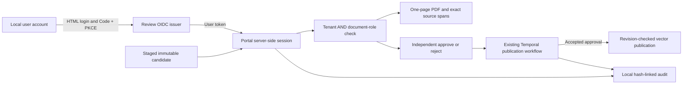

# Review the source before publishing it

The review portal adds an actual browser login and document-review interface to
the existing durable publication workflow. A person can compare an individually
permitted PDF page with its canonical extracted text, inspect the exact chunk
spans and tenant/role grants, then approve or reject that immutable candidate.
The UI shows the accepted decision separately from completed publication.

The reproduction harness uses **scripted local user accounts**, real HTTP,
`oidc-provider`, Temporal, PDF/OCR, MiniLM ONNX and Qdrant. Automated form
submissions and browser clicks do not establish that a person read, understood
or approved a source. No owner review or personal study is claimed.

## Run the complete local demo

Use **Python 3.12+**, **Node.js 24** and **Tesseract 5 with English data** on macOS
arm64 or Linux amd64. Install the three compatible optional runtime locks in
one environment:

```sh
python3.13 -m venv .venv-review
.venv-review/bin/python -m pip install \
  -r requirements-rag.lock -r requirements-ingestion.lock -r requirements-approval.lock
.venv-review/bin/python -m pip install --no-deps -e .

# Use a separate checkout if an existing one has local changes.
git clone https://github.com/edsonsims/identity-boundary-lab ../identity-boundary-lab
(cd ../identity-boundary-lab && \
  git checkout 70e663c69ad96997c394581fa9df33487d2e3390 && \
  npm ci --ignore-scripts && npm run build)

# Explicit one-time, hash-verified downloads. Serving does not fetch assets.
.venv-review/bin/python -m enterprise_ai_lab.rag.models bootstrap \
  --model-dir .local/models/minilm
.venv-review/bin/python -m enterprise_ai_lab.approval.bootstrap bootstrap \
  --directory .local/temporal-bin

.venv-review/bin/python -m enterprise_ai_lab.review demo \
  --temporal-cli .local/temporal-bin/temporal \
  --identity-dir ../identity-boundary-lab --node node \
  --model-dir .local/models/minilm \
  --manifest public-data/pdf-v1/ingestion.json \
  --work-dir .local/review-demo \
  --out reports/local/review-demo.json
```

Use a **fresh work directory** for each independent run. Pass the absolute Node
24 executable if `node` resolves to another release. The demo generates unique
fixture passwords in `accounts.private.json`, an owned mode-0600 file under the
private work directory. Do not commit it, print it in reports, or substitute an
existing person's password. Signing keys, provider sessions and grants are
in memory. The password file is a local fixture, not a production user directory.

The pinned Identity commit has a [successful Node 22/24 run](https://github.com/edsonsims/identity-boundary-lab/actions/runs/39139597620)
of its 100 issuer tests and original service demo. The
[browser identity protocol](https://github.com/edsonsims/identity-boundary-lab/blob/70e663c69ad96997c394581fa9df33487d2e3390/docs/browser-review.md)
explains the registered client, fixture file and permitted scopes.

### Exercise the actual browser

The default demo checks the real cookie/redirect/form protocol through HTTP; it
is separate from a rendered browser check. The optional browser pass uses the
locked Playwright development dependency and actual Chromium. From this
repository, explicitly install the browser assets first:

```sh
npm ci --ignore-scripts
npx playwright install chromium
```

On Linux, install Chromium's required platform libraries for that environment
as well. Then run the same demo with a fresh directory and `--browser-test`:

```sh
.venv-review/bin/python -m enterprise_ai_lab.review demo \
  --temporal-cli .local/temporal-bin/temporal \
  --identity-dir ../identity-boundary-lab --node node \
  --model-dir .local/models/minilm \
  --manifest public-data/pdf-v1/ingestion.json \
  --work-dir .local/review-browser-demo \
  --out reports/local/review-browser-demo.json \
  --browser-test
```

The browser logs in through the actual issuer form, waits for decoded PDFium
PNG page images, checks the permitted single-page PDF links and exact source
spans, clicks approval and rejection, observes durable publication and audit,
checks tenant isolation, signs out and checks a narrow viewport. It does not intercept API routes or inject sessions. Read the
[browser protocol](../tests/review/browser-protocol.md) before interpreting its
assertions. Python independently parses preview PDFs to check the page count;
a browser response header alone is not a second page-count measurement.

### Open it for a person

Append `--stay-open` to keep the local services running after the scripted
checks. The final local `ready` event gives the portal URL and private account
file path. Open that URL and use a fixture account from that file. Keep the
credentials and raw browser/session traffic private. Stop the command when
finished; the services bind only to literal `127.0.0.1`.

After the scripted checks, `--stay-open` creates two separate pending manual
exercises: `hands-on-review` and `hands-on-reject`. They are excluded from the
frozen automated report and are not evidence of a person's review. Sign in as
`analyst-reviewer-alpha` to inspect both pages and try the decisions before the
request deadline; use `reviewer-alpha` to see the restricted reading view.
Completed requests are not resettable visual samples. A new independent run
requires a fresh work directory and produces a separate report.

## Follow the account and document boundary



The browser client is public `review-portal`, with an exact loopback callback,
Authorization Code only and required PKCE S256. Login requests use state and
nonce. The portal binds the callback to a short-lived browser cookie, consumes
the pending login once, redeems the code without redirects, and independently
verifies the ID/access signatures and claims. The ID token must match the
nonce, user subject, client audience and recent `auth_time`.

The access token's audience is **`urn:identity-boundary:review`** and its
`identity_kind` must be `user`. Its `sub` identifies the authenticated fixture
account, separately from the shared OAuth application client ID. Roles and
tenant come from the issuer's registered profiles, never JSON, headers, PDF
metadata, model output or a browser-selected tenant. The original service
RAG/approval tokens are not browser login credentials.

| Fixture account | Tenant | Roles | What the mixed native/OCR Alpha request permits |
| --- | --- | --- | --- |
| `requester-alpha` | Alpha | requester, reader | Submit the immutable candidate; read only the native reader page |
| `reviewer-alpha` | Alpha | approver, reader | Read the native page; OCR withheld; neither approve nor reject the incomplete batch |
| `analyst-reviewer-alpha` | Alpha | approver, reader, analyst | Read both pages and decide the complete batch independently |
| `reviewer-beta` | Beta | approver, reader | Read/decide Beta's grants; no Alpha queue or document access |
| `reader-alpha` | Alpha | reader | Read granted content; no decision permission |
| `observer-alpha` | Alpha | observer | Login can succeed; review reads and decisions remain forbidden |

The issuer grants `review:read`, `review:request` and `review:decide` only when
its profile allows them. The portal checks scope and role separately. All
candidate documents must be readable before **either approval or rejection**.
An approver role does not bypass an `analyst` document grant, and the requester
cannot accept its own review. The complete immutable snapshot, signed-in actor,
command and deadline still pass through the existing Temporal validation.

The browser receives an opaque HttpOnly SameSite cookie and a CSRF value, not
an OAuth token. Bearer tokens stay in portal memory. Every protected request
revalidates the token, and mutations require same-origin JSON plus the session's
CSRF header. The portal rejects mismatched Host, ambiguous cookies, spoofed
identity headers, unexpected query fields and unbounded JSON. User-token
lifetime defaults to **300 seconds** and is bounded to **600 seconds**; original
service tokens keep their 60-second bound. Expiry or a portal restart requires
login again. Logout removes the server session; it does not revoke an already
issued offline JWT.

## Compare PDF pages and exact chunks

The review copies reuse the two selected public NIST pages from the
[PDF study](../public-data/pdf-v1/README.md). The originals and existing clean
image-only OCR derivative remain unchanged. Their source rights and derivative
notices are separate from the code's MIT license; NIST does not endorse the lab.

The page view is a **PDFium-rendered PNG** of the individually authorized page,
shown beside the canonical text and chunks. An explicit link opens a separately
labelled **single-page PDF derivative**. The OCR view renders artifact page 1;
its original-page comparison renders original physical page 25. Native text
comes from original physical page 15. Both the image and PDF routes require the
same document permission. Before producing either preview, the server verifies
both original and artifact hashes against the candidate and its trusted local
manifest. Browser filenames or paths cannot select arbitrary source files.

PDFium renders the verified one-page PDF at 108 dpi, with pre-allocation
dimension/pixel limits and a PNG byte limit. The response records the image's
own SHA-256 and dimensions separately from its PDF preview hash. The browser
check waits for actual decoded pixels, compares image dimensions with the PNG
header and also requests the authorized PDF bytes. Python separately parses
those PDF bytes to verify one page. The visual preview does not rewrite the
canonical extracted text, source hashes or chunk offsets.

The preview response records its own hash in `X-Preview-SHA256`, separately
from the original/artifact headers. The UI shows the tenant, roles, extraction
method, original URL, original/artifact hashes and physical pages, canonical
page-text hash, text and exact chunk offsets. OCR
word boxes/confidence remain source diagnostics; confidence is not calibrated
accuracy. Every chunk must equal its canonical text slice. The unchanged
publication gate later indexes that same content and provenance.

The trusted preview mapping is local. This is not a public PDF-upload endpoint,
a hostile-document sandbox, whole-publication download entitlement, live
permission connector or a guarantee that all PDF layouts render/extract safely.

## Audit a decision without pretending it is a transaction

The local SQLite audit records signed-in login/logout, permitted review/PDF/image
views, request and decision intents, denied decisions, accepted workflow
receipts and observed publication. It stores identifiers, immutable hashes,
action/result and timestamps, **not passwords, bearer tokens or document text**.
The candidate store and private source files separately contain document text.

Events form an append-only, hash-linked chain. The server checks the complete
chain before returning the authorized subset. A review event is visible only to
an approver who can read the whole batch in that tenant; login/logout events
and redacted personal PDF/image denials are private to their actor. A local administrator can replace the database and
all hashes. This is not an externally anchored or tamper-proof audit service.

The portal records an intent before calling Temporal. An accepted decision can
outlive a process failure before the next audit append; later reads reconcile
its immutable durable receipt. Exact event keys avoid duplicating reconciled
acceptance/publication events. A workflow decision observed without a matching
browser intent is labelled `service_or_unknown`, not silently called a user
review. There is **no cross-database transaction** between portal audit, Temporal,
publication ledger and Qdrant. Accepted approval and completed publication stay
separate observations.

## HTTP surface and verification

| Route | Purpose |
| --- | --- |
| `GET /login`, `GET /auth/callback` | Actual Code + PKCE login and bound callback |
| `GET /api/session` | Safe user/tenant/roles, session expiry and CSRF value; no JWT |
| `GET/POST /api/reviews` | Account-scoped queue and immutable requester submission |
| `GET /api/reviews/{id}` | Permitted text/chunks and durable request state |
| `POST /api/reviews/{id}/decisions` | Independent full-batch approval/rejection with CSRF |
| `GET /api/reviews/{id}/documents/{doc}/preview.png` | PDFium-rendered PNG of the individually permitted artifact page |
| Same image route with `?variant=original` | Rendered comparison of the individually permitted original page |
| `GET /api/reviews/{id}/documents/{doc}/pdf` | Link to the individually permitted single-page artifact PDF |
| Same PDF route with `?variant=original` | Individually permitted original-page PDF derivative |
| `GET /api/audit` | Tenant/role/document-scoped local audit events |
| `POST /logout` | Remove this opaque server session |

Focused boundary tests:

```sh
.venv-review/bin/python -m pytest tests/review -q
```

Without opt-in flags, these include controlled signing keys, exchange/gateway
doubles, negative claims, session/CSRF checks, real SQLite integrity/reconciliation
and PDF preview boundaries. Enable the actual process and Chromium path after
installing the declared runtimes:

```sh
RUN_REVIEW_INTEGRATION=1 RUN_REVIEW_BROWSER=1 \
TEMPORAL_CLI="$PWD/.local/temporal-bin/temporal" \
RAG_MODEL_DIR="$PWD/.local/models/minilm" \
IDENTITY_LAB_DIR="$PWD/../identity-boundary-lab" NODE_BINARY=node \
.venv-review/bin/python -m pytest tests/review -q
```

An enabled integration fails if its declared runtime is missing. Run the prior
suites with their documented integration flags as well; the original lexical,
synthetic RAG, PDF, local-note and publication reports remain separate and
unchanged. The [frozen review run](../reports/review-v1/demo.json) records 37 HTTP
observations, four one-page PDF preview responses, four publication effects,
six exported/replayed histories and 85 audit rows. Its
[Chromium record](../reports/review-v1/browser.json) retains 11 passing checks,
actual PNG decoding, the browser version and screenshots. Audit row totals can
vary with page-view and polling timing; they are not a fixed benchmark.

Combined local verification on Python 3.13.1/macOS arm64 passed **439 tests and
247 subtests**, with all RAG/PDF, approval, publication and review integrations
enabled, including actual Chromium. Review contributes 75 focused tests and ten
actual process tests; the original 14-test dependency-free baseline and
byte-identical reference demo remain unchanged.

Local administrators, trusted manifests, the source directory and the
unauthenticated development Temporal gRPC endpoint remain trusted. Production
HTTPS, external SSO/federation, persistent issuer/session state, key rotation,
MFA, live entitlement synchronization and production administration are not
implemented. Two public English pages and fictional account policy establish
no broad OCR, security or answer-quality benchmark.

## Study exercises

1. Sign in as `reviewer-alpha`, inspect the native page and try the hidden OCR
   URL. Explain why a valid approver account cannot decide that whole batch.
2. Compare OCR artifact page 1 with original physical page 25. Resolve a chunk's
   half-open Unicode offsets into the canonical page text; keep all three PDF
   hashes distinct.
3. Approve with the independent analyst reviewer. Observe the accepted receipt,
   then wait for publication and query the RAG as reader and analyst separately.
4. Restart the portal. Verify that the old cookie fails, sign in again and
   compare the retained audit event hashes and durable decision.
5. Inject the controlled receipt/audit gap in its test. Explain what later
   reconciliation restores and what a host administrator could still falsify.

Record owner reflection only after the owner actually performs an exercise.


## Why both protocol and rendered-browser tests matter

The direct HTTP login check supplied its Origin explicitly and initially missed
a real browser failure. A no-referrer policy made Chromium submit `Origin: null`,
which the strict form check refused. The issuer now uses `same-origin` referrer
policy. A second Chromium run exposed CSP `form-action` applying to the redirect
chain; the issuer permits only self and the statically registered portal origin.
It still rejects null Origin, cross-origin submissions and unregistered callbacks,
and still checks CSRF and PKCE. The subsequent real Chromium flow passes. The retained runtime provenance
includes hashes of both built `review-bridge.js` and `review-issuer.js`, alongside
actual Python/Node, PDF/OCR, Temporal, ONNX and vector runtime versions. The
[recorded evidence](../reports/review-v1) preserves that distinction; a successful
hand-authored HTTP request alone would not establish working browser login.
