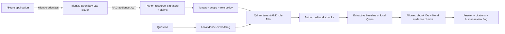

# From a verified identity to retrieved evidence

The resource in this study lives in Python. Identity Boundary Lab supplies the
actual local OAuth issuer; Enterprise AI Lab validates the access token and owns
the document index, retrieval policy and answer step. No caller-supplied tenant
or role header becomes an authenticated principal.

## Request boundary

`POST /v1/tenants/{tenant}/rag` accepts a Bearer JWT and this JSON body:

```json
{"query":"What is the processing limit?","top_k":3}
```

The configured issuer is an explicit `http://127.0.0.1:port` origin. Startup fetches
its discovery document and public JWKS, without environment proxies or redirects.
Discovered keys must remain on that exact origin. JWT validation pins RS256,
`at+jwt`, issuer and audience `urn:identity-boundary:rag`; it checks required
identity/time claims and the maximum 60-second lifetime. Token-supplied key URLs
are never fetched. The JWKS is a startup snapshot, with no automatic key rotation.

After verification, the requested tenant must match the signed tenant. The token
must contain `rag:query` and a reader or analyst role. Document access is narrower:
the vector query requires both the tenant and an intersection between the signed
roles and the document's `allowed_roles`.



The filter is part of the vector-store query **before top-k**. A second check
rejects any returned payload that disagrees with the authenticated principal.
There is no global-result fallback. Unauthorized chunks cannot become generator
context, citations or a successful response through this application path.

## Input and failure behavior

Only `query` and `top_k` are accepted. Questions are limited to 2,000 characters
and 256 embedding tokens; excess tokens are rejected, never silently truncated. Identity override fields in JSON fail
validation; `X-Tenant-Id`, `X-Roles` and similar identity headers are rejected.
There must be exactly one bounded Authorization header. Query-string transport
is rejected. Bodies have a 16-KiB cap, a total read deadline and strict JSON checks
for duplicate keys, nonfinite numbers, invalid Unicode and excessive nesting.

| Status | Meaning |
| --- | --- |
| 200 | A completed retrieval/answer result, including explicit empty-context abstention |
| 400 | Ambiguous JSON, identity override headers or query-string parameters |
| 401 | Missing, malformed, expired or inappropriate access token |
| 403 | Verified token lacks the requested tenant, required scope or access role |
| 408 / 413 / 415 / 422 | Body deadline, byte limit, content type or schema failure |
| 503 | Worker busy, failed retrieval or rejected/failed generation |

Errors do not echo access tokens, submitted query text, model prompts or source
bodies. A rejected generator result is an error; it is not replaced silently by
the extractive answer. One request at a time uses the local vector/model worker.
This is admission control for the study, not a throughput or availability claim.

## Retrieval and generation are separate evidence

The persistent store uses Qdrant's local implementation, with actual dense ONNX
embeddings. It is a single-process, file-backed vector store; this study does not
exercise a remote Qdrant server, distributed indexing or production HNSW behavior.
Only the explicit bootstrap command downloads model assets. Serving verifies the
pinned local files and never downloads a model while answering a request.

The default generator returns quoted authorized context as an inspectable
extractive baseline. The optional Qwen adapter performs actual local CPU decoding
from the same filtered chunks. It requires a pinned model/runtime, bounded input
and output, and one structured result with allowed chunk IDs and exact quotes.

Literal quote validation establishes where cited text came from. It does not
establish that the answer follows from the quote, that the quote answers the
question, or that the model resisted every instruction embedded in a document.
Every answer retains `human_review_required: true`. No tool execution or external
retrieval is available to the generator.

## Permissions, updates and revocation

Fixture ACLs are authored metadata. The network API is query-only; it exposes no
unauthenticated upload, ACL edit or collection-management endpoint. Trusted local
ingestion and ACL-update methods operate on the actual store. They require the
same exclusive store ownership as other local writes.

A document ACL update affects subsequent retrieval. Every local mutation first
writes a durable pending marker. If a write is interrupted or fails midway, the
current process and a restarted resource refuse to query that directory. Rebuild
from trusted source documents into a fresh directory before serving again. This
trades availability for refusing partially updated permissions; it does not claim
power-loss durability or a distributed transaction.

Already returned text cannot be withdrawn. Token roles remain a snapshot until expiry, and offline JWT
validation does not observe revocation or account changes. The separate Identity
Boundary Lab reports demo compares opaque-token introspection with JWT behavior;
this RAG resource accepts the dedicated JWT audience only.

The demo restarts the Python resource while keeping the actual issuer running,
then queries the persisted vectors without re-seeding. Restarting the issuer
creates new signing keys; the resource must restart to trust the new snapshot.

## What to study next

1. Trace a valid token from the real token endpoint to the Qdrant filter.
2. Make a denied document the globally closest vector and keep `top_k=1`.
   Explain why filtering global top-k afterward loses permitted context.
3. Change a document's roles and compare subsequent queries with previously
   returned content.
4. Compare empty authorized context with permitted but irrelevant context.
5. Inspect one accepted model quote that does not support a useful answer.
6. Design production identity/key lifecycle and an independently labelled
   retrieval/answer-quality corpus before making deployment or accuracy claims.

Owner completion of these exercises has not been reported.

## Primary references

- [Qdrant filtering](https://qdrant.tech/documentation/concepts/filtering/)
- [Qdrant Python local mode](https://github.com/qdrant/qdrant-client#local-mode)
- [FastEmbed](https://github.com/qdrant/fastembed)
- [PyJWT verification API](https://pyjwt.readthedocs.io/en/2.15.1/api.html)
- [JWT access-token profile, RFC 9068](https://www.rfc-editor.org/rfc/rfc9068)
- [Official Qwen3-0.6B model](https://huggingface.co/Qwen/Qwen3-0.6B)
