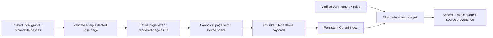

# From a PDF page to authorized evidence

This path adds native PDF extraction and actual OCR to the existing OAuth →
MiniLM → Qdrant → cited-answer demo. It ingests two selected English pages from
public NIST publications, with authored tenant and role grants. The original
synthetic retrieval studies remain separate.

## Run it locally

Use **Python 3.12+**, **Node.js 24**, and **Tesseract 5 with English language
data**. Tesseract is a system dependency, not a Python package. For example,
install `tesseract` with Homebrew on macOS, or `tesseract-ocr` and
`tesseract-ocr-eng` with the system package manager on Ubuntu. Verify that
`tesseract --list-langs` includes `eng`.

From this repository:

```sh
python3.13 -m venv .venv
.venv/bin/python -m pip install -r requirements-rag.lock -r requirements-ingestion.lock
.venv/bin/python -m pip install --no-deps -e .

# Use a sibling checkout; skip cloning if it already exists.
git clone https://github.com/edsonsims/identity-boundary-lab ../identity-boundary-lab
(cd ../identity-boundary-lab && npm ci --ignore-scripts && npm run build)

# Explicit, one-time download. Ingestion and answering load verified local assets.
.venv/bin/python -m enterprise_ai_lab.rag.models bootstrap --model-dir .local/models/minilm

.venv/bin/python -m enterprise_ai_lab.rag pdf-demo \
  --manifest public-data/pdf-v1/ingestion.json \
  --identity-dir ../identity-boundary-lab \
  --model-dir .local/models/minilm --store .local/pdf-demo \
  --out reports/local/pdf-demo.json
```

Use `--node /absolute/path/to/node` if Node 24 is not the default executable.
The demo starts the real local issuer and Python resource, ingests the PDFs,
queries with actual signed tokens, and reopens the persisted index. Its answer
step is the existing **extractive baseline**; this command does not call an LLM.
The optional Qwen generator remains a separate experiment.

The [recorded public run](../reports/pdf-v1/demo.json) retains the complete
responses and extraction provenance. The [fixture manifest](../public-data/pdf-v1/manifest.json)
identifies the exact source bytes and how the OCR input was made. No document
download occurs during ingestion or answering; source URLs are citations.

The recorded run has **nine HTTP cases, four page grants and 28 chunks**. A
second ingestion leaves the count at 28 with identical page text and metadata.
The specific question “What functions is the Core composed of?” returns the OCR
sentence naming GOVERN, MAP, MEASURE and MANAGE. The generic “What are the four
functions?” abstains despite authorized source material; that observation remains
in the report. These controls demonstrate the exercised paths, not general
question-answering quality.

To index the same local grants without starting the issuer/resource demo:

```sh
.venv/bin/python -m enterprise_ai_lab.rag ingest \
  --manifest public-data/pdf-v1/ingestion.json \
  --model-dir .local/models/minilm --store .local/pdf-index \
  --out reports/local/pdf-ingestion.json
```

The index schema is now **version 2**, which retains source spans. Use a fresh
store directory when moving from the earlier schema; the loader rejects a
mismatched fingerprint. Do not edit `rag-index.json` to bypass that check.

## What is actually ingested

| Public material | Selected input | Extraction | Local grants |
| --- | --- | --- | --- |
| NIST SP 800-207, *Zero Trust Architecture* | Physical PDF page 15, printed page 6 | Native `pypdf` text | Alpha reader; Beta reader |
| NIST AI 100-1, *AI RMF 1.0* | Image-only derivative page 1, mapped to original physical PDF page 25 / printed page 20 | PDFium rendering → Tesseract | Alpha analyst; Beta reader |

Those grants are a test policy. They do not describe NIST access restrictions.
Public availability of the sources does not bypass the local API's tenant and
role checks. The same public page can have different grants in each tenant.

The unchanged original PDFs are retained. The image-only input is a **labelled
lab-created raster derivative**, made from a clean public page; it is not a
historical scan. The demo exercises two distinct pages, with one OCR page reused
under two tenant grants. It is not an OCR accuracy or document-quality benchmark.
It does not cover handwriting, skew, damaged scans, multilingual pages or faithful
diagram/table reconstruction.

The publications retain their own rights; the repository's MIT license applies
to the code. See [rights, attribution and the modification notice](../public-data/pdf-v1/README.md).
NIST has not reviewed or endorsed the lab.

## How a citation survives extraction



Each page and retrieved chunk retain these fields:

| Field | Meaning |
| --- | --- |
| `source_id`, `source_uri` | Public publication identity and citation URL; never a fetch instruction |
| `source_sha256`, `source_page` | Original publication bytes and one-based physical PDF page |
| `artifact_sha256`, `artifact_page` | Bytes actually processed and their one-based page; different for the raster derivative |
| `method` | `native` or `ocr`, from the extraction engine |
| `page_text_sha256` | SHA-256 of the complete canonical page text encoded as UTF-8 |
| `start`, `end` | Half-open Python Unicode code-point offsets into that canonical page text |
| `ocr_words` | Retained complete word spans, rendered-image pixel boxes and Tesseract confidence diagnostics |
| `render_dpi`, `width_px`, `height_px` | The actual OCR render coordinate system; native extraction has no OCR geometry |

The original PDF page and the ingested artifact page are separate facts. For
the OCR fixture, artifact page **1** maps to original page **25**. That mapping
is an explicit local operator assertion, recorded alongside both hashes and
the derivative's build procedure; OCR cannot establish it independently. The
loader checks original-page bounds and rejects remapping when the original and
artifact hashes are identical, even if the files have different names.

Native canonicalization changes CRLF/CR line endings to LF and strips outer
whitespace. It does not normalize Unicode or collapse interior spaces. OCR
canonical text is reconstructed from Tesseract TSV word order, with spaces
between words and newlines between detected lines. The returned spelling and
confidence values are preserved, including low-confidence words.

Chunks are exact substrings of that canonical text and do not cross a page.
The extractor computes the page-text hash; the complete page document verifies
that hash, span lengths and OCR word offsets before indexing. A chunk retains
only word boxes fully inside its span; a boundary can
cut a word. Boxes use top-left-origin pixels in the **rendered artifact**, not
original PDF text coordinates. Tesseract's 0–100 confidence values are diagnostic
scores, not calibrated correctness probabilities. Native reading order and OCR
layout are approximations; a literal source quote does not establish that an
answer is correct or semantically supported.

The [retained text-layer comparison](../reports/pdf-v1/text-layer-comparison.json)
shows real differences on the selected AI RMF page: merged words, punctuation
spacing and diagram labels missing from native extraction but present in OCR.
Both complete streams and alignment differences are retained. The native layer
is not human ground truth, and the alignment ratio is not OCR accuracy. Run
`python scripts/compare_pdf_text_layers.py` in the locked ingestion runtime to
reproduce this diagnostic. More varied scans and a reviewed transcription corpus
are needed before measuring OCR quality.

## Permissions and repeat ingestion

`ingestion.json` is trusted local configuration. It names only relative local
paths contained under its own directory, pins file hashes, selects pages, and
assigns tenant/role grants. PDF metadata, text, attachments, links and model
output never choose ACLs or authenticated identity. The HTTP resource remains
query-only; this is not a public upload endpoint.

Document IDs derive from **tenant + source ID + original source page**. Repeating
the same grant replaces that tenant's existing page and ACL-bearing chunks,
rather than appending another copy. Changing roles does not change the document
ID. Another tenant receives a different ID even for identical public PDF bytes.
Duplicate grants for the same tenant/source/page are rejected; combine their
allowed roles explicitly.

An authenticated query must match the signed tenant and intersect the document's
allowed roles. That condition is part of the Qdrant query before top-k and is
checked again on returned payloads. The generator and citations receive only
that authorized context. Neither a matching public URL nor a requested tenant
header grants access.

All entries and selected pages are extracted before one guarded index mutation.
A corrupt, encrypted, empty, out-of-range or oversized selected page rejects
the entire incoming batch. Extraction and embedding failures leave the existing
index content in place. During an index write, a durable pending marker makes
an incomplete mutation refuse subsequent reads and refuse startup after restart.
Recovery is a rebuild from trusted inputs into a fresh directory, not removal
of the marker. This is fail-closed recovery, not a bulk database transaction.

Re-ingestion updates only the pages named in that batch. **Omitting a page or a
tenant is not a deletion request.** Remove obsolete pages with the store's
guarded delete operation, or rebuild a fresh index from the intended complete
set. Already returned text cannot be withdrawn, and signed JWT roles remain
unchanged until expiry.

## Bounded local processing

The defaults accept at most 15 MB per regular PDF file, 250 total PDF pages and
12 explicitly selected pages per extraction. Each selected page is limited to
15 million rendered pixels, 8 MB decoded native content, 80,000 text characters
and 15,000 OCR words; the extraction has a 300,000-character aggregate cap.
The OCR render is 180 dpi. Tesseract has a 30-second per-page timeout, and the
whole extraction worker has a 120-second deadline. Timeout/crash cleanup kills
the worker's OCR process group on POSIX systems. Linux also applies child
address-space and CPU limits; macOS relies on the deadline and structural caps.

The local manifest adds its own entry/page-grant caps, and the RAG document
contract has a stricter 50,000-character page limit. Chunks have a 500-character
limit, and the pinned embedding tokenizer rejects inputs above 256 tokens
instead of silently truncating them. An empty native page automatically uses
actual OCR; `ocr_pages` can force OCR for a selected page whose embedded text is
not suitable. A nonempty text layer is not an assurance of extraction quality.

There are no model or network calls inside the extraction engine. Parser and
rendering work run in a child process, but this local operator tool is **not a
security sandbox for hostile uploads**. It does not implement malware scanning,
document entitlement synchronization or production ingestion scheduling.

## Test the real integration

```sh
RUN_RAG_INTEGRATION=1 \
RAG_MODEL_DIR="$PWD/.local/models/minilm" \
IDENTITY_LAB_DIR="$PWD/../identity-boundary-lab" \
.venv/bin/python -m pytest tests/rag tests/ingestion -q
```

The extraction suite opens real PDF files, renders image-only pages and executes
Tesseract. Separate boundary cases exercise byte/page/pixel/text limits,
encryption, malformed files, invalid selections and actual process timeouts.
The public-document integration uses the real issuer, signed JWTs, resource
HTTP, MiniLM embeddings and persisted Qdrant. It checks citation spans, role and
tenant denial, re-ingestion and reopening the index. Controlled vectors, authored
negative PDFs and injected write failures are identified as controlled tests;
they do not stand in for OCR accuracy measurements or a production assessment.

For the existing token and generation boundaries, read
[Identity → RAG design](identity-rag.md). Owner study and human review remain
unclaimed until the owner reports them.

## Primary references

- [pypdf text extraction and its limitations](https://pypdf.readthedocs.io/en/latest/user/extract-text.html)
- [PDFium rendering API](https://pypdfium2.readthedocs.io/en/stable/python_api.html)
- [Tesseract TSV output](https://tesseract-ocr.github.io/tessdoc/Command-Line-Usage.html#tsv-output)
- [Public document provenance and rights](../public-data/pdf-v1/README.md)
