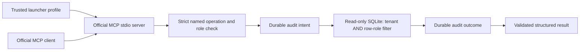

# A small MCP surface over a local database

The question for study 7 is deliberately narrow: can an actual MCP client read
useful legacy-shaped records while the database, tool catalog and audit each
enforce the intended boundary?

This milestone uses the **official Python MCP SDK 2.3.0**, a real stdio child
process and SQLite. The records are [authored synthetic work orders](../src/enterprise_ai_lab/mcp_gateway/data/README.md),
not an exported company database. No model, Oracle, SAP, remote transport or
external identity service is connected. The existing approved RAG publication
path is a separate study; this gateway exposes no write or approval operation.

## Run it

Use Python **3.12+** on macOS/Linux. The original dependency-free evaluator
still supports Python 3.10; that does not describe this optional locked stack.

```sh
python3.13 -m venv .venv-mcp
.venv-mcp/bin/python -m pip install -r requirements-mcp.lock
.venv-mcp/bin/python -m pip install --no-deps -e .
.venv-mcp/bin/python -m pip check

.venv-mcp/bin/python -m enterprise_ai_lab.mcp_gateway demo \
  --work-dir .local/gateway-demo --out reports/local/gateway-demo.json
.venv-mcp/bin/python -m pytest tests/gateway -q
```

Use a **fresh work directory** for each demo. Package installation is explicit;
the serving process and demo never download packages, models or data. No Node,
Temporal server, model weights or credentials are needed for this milestone.
The MCP lock shares exact dependency versions with the existing three locks;
the combined environment is also regression-tested separately.

To initialize the fixture and launch one fixed profile yourself:

```sh
.venv-mcp/bin/python -m enterprise_ai_lab.mcp_gateway init \
  --database .local/manual-gateway/source.sqlite
.venv-mcp/bin/python -m enterprise_ai_lab.mcp_gateway serve \
  --database .local/manual-gateway/source.sqlite \
  --audit .local/manual-gateway/audit.sqlite --profile alpha-reader
```

`serve` expects an MCP client on stdin/stdout. It does not print a human prompt;
stdout is reserved for JSON-RPC. The initializer refuses an existing database,
and serving does not seed one. Diagnostics use stderr.

An official client can launch that exact process with
`Client(StdioServerParameters(command=..., args=[...]), mode="auto")`.
See the [executed client](../src/enterprise_ai_lab/mcp_gateway/integration.py).
Record `client.protocol_version`: a package version does not establish which
protocol was used. The recorded run discovers **2026-07-28** and separately
exercises the **2025-11-25** legacy initialize handshake. SDK 2 removed the old
`mcp.server.fastmcp` import; this implementation uses its public low-level
`Server` callbacks to preserve raw rejected arguments for auditing.
[Official pinned SDK](https://pypi.org/project/mcp/2.3.0/) ·
[Tool semantics](https://modelcontextprotocol.io/specification/2026-07-28/server/tools)

## Who chooses the identity?

The **trusted local launcher** selects one immutable profile. This is authored
local policy, **not login or remote authentication**. A caller who controls the
launcher or filesystem controls this boundary; starting a process with another
profile is not prevented by the study.

| Profile | Tenant | Reading roles | Visible tools |
| --- | --- | --- | --- |
| `alpha-reader` / `beta-reader` | Alpha / Beta | reader | list work orders; get work order |
| `alpha-analyst` / `beta-analyst` | Alpha / Beta | reader + analyst | the two reads; asset diagnostics |
| `alpha-observer` | Alpha | observer | none |

The catalog hides tools outside the profile, and the service independently
rejects direct calls to them. Arguments cannot set tenant, role, subject, SQL,
file paths or a connection string. Exact schemas and service validation reject
unknown fields, coercion, boolean page limits and invalid identifiers. A tool
error has MCP `isError: true`; it does not contain success-shaped source data.

## From request to row



The fixture has **18 work orders and six diagnostic records** across two
tenants. IDs deliberately collide across tenants. Restricted work orders are
interleaved with reader-visible rows. SQL applies tenant equality **and** the
row-role intersection before ordering and `LIMIT`; filtering a global result
page afterward would leave short pages and risk exposing another tenant's rows.

For example, Alpha reader pages of size two return:

```text
WO-0001, WO-0003  →  WO-0005, WO-0006  →  WO-0008, WO-0009
```

An analyst can also read `WO-0002`, `WO-0004` and `WO-0007`. Alpha and Beta's
`WO-0001` return different tenant-bound records. Missing and unreadable work
orders produce the same `not_found` response. Diagnostics additionally require
analyst role and their own tenant/row grant.

`after_id` is an explicitly visible last-row ID, **not** an opaque MCP catalog
cursor or an authorization token. An unreadable cursor is refused. This fixed
read-only fixture avoids mutation between pages; no snapshot guarantee for a
live changing enterprise database is claimed.

## Database and audit fences

The source opens with SQLite URI `mode=ro`, `query_only=ON`, disabled extensions
and an authorizer restricting tables/columns and refusing writes, metadata
queries, functions and `ATTACH`. Fixed parameterized statements are the only
service operations. Startup bounds the file and schema; reads have a 50 ms busy
timeout and a progress-handler execution budget. The filesystem and schema
owner remain trusted; this is not a hostile database-file sandbox.

The audit lives in a **different SQLite database**. Before opening it and before
each call, the service checks the main files and SQLite `-wal`, `-shm` and
`-journal` families, including existing inode aliases. This prevents an audit
sidecar from overwriting the source through a hardlink. A real-file regression
was added after independent automated review reproduced that failure.

Every attempt stores a committed intent before source SQL and a committed
outcome before returning. Audit failure before intent prevents the read; failure
after the read withholds the data and leaves an unfinished intent. An explicit
retry is another read and another audit attempt. There is no atomic transaction
across the two databases and no claim that a timeout means the read did not run.

Events contain subject, tenant, safe operation name, time, row count, outcome
and input/output digests. They exclude row bodies, raw arguments and credentials.
Bounded JSON gets an exact canonical command digest; oversized or non-JSON input
gets a **labelled rejected-descriptor digest**, not a falsely claimed exact hash.
Unknown tool names become `unknown_tool` in the audit.

Append-only triggers and a fully validated hash chain detect ordinary edits and
corruption. This is local integrity evidence, **not an externally anchored log
against a host administrator**. The chain is bounded to 10,000 events; reaching
the limit refuses further calls rather than truncating evidence. Retention,
archival and external anchoring are future work.

## Deadlines and process lifetime

The SDK read timeout is supplemented by an independent AnyIO total budget.
SQLite also has its own busy/progress limits. The adapter waits for bounded
thread work on cancellation; cancelling an await does not prove SQLite was
forcibly interrupted or that a durable audit record was rolled back.

Actual process tests hold an exclusive source lock, exercise both a caller
deadline and SDK timeout/cancellation, release the lock, then successfully read
again through the same client. The official stdio transport owns shutdown and
reaping. The demo observes real child PIDs through `ps` and checks they no longer
exist after context exit; it does not infer cleanup from a closed Python object.

## Read the evidence

[The frozen run](../reports/gateway-v1) keeps complete synthetic responses,
actual negotiated protocols, catalog schemas/annotations, source hashes,
client/server runtime fingerprints, process exit checks and the metadata-only
audit. It labels exclusive database locks, copied-audit corruption and a direct
read-only engine probe separately from normal protocol calls. Tool annotations
are hints; SQL/service checks enforce access. Repeating a read leaves business
data unchanged while appending more audit events.

| Choice | Benefit here | Cost / limit |
| --- | --- | --- |
| stdio with a fixed launcher profile | Reproducible local process boundary without credentials | Launcher and host remain trusted; no remote IAM |
| Named parameterized reads | Small inspectable permission surface | New operations need explicit design and tests |
| Tenant/role filter inside SQL | Full authorized pages and tenant-bound IDs | Each query and index needs permission-aware design |
| Read-only URI plus query/authorizer guards | Layered refusal of mutations | No action/transaction integration yet |
| Two durable audit writes per attempt | Honest before-read and before-response evidence | Added latency, finite retention and possible unfinished intents |
| Complete chain verification | Corruption refuses data | Linear local verification; not an administrator-proof anchor |

This is interoperability and failure-boundary evidence, not model-quality,
enterprise adoption, production security or customer validation. Automated
accounts, tests and reviews do not establish owner study or human review.

## Study exercises

1. Remove the SQL role predicate on a disposable branch. Explain which real
   page/detail tests fail and why filtering after `LIMIT` is insufficient.
2. Compare Alpha and Beta's colliding IDs in the raw report. Trace the trusted
   principal into both the SQL parameters and audit event.
3. Hold the audit write lock, then the source lock. Explain why the first must
   prevent the query and the second may leave an audited error.
4. Inspect a surviving intent after an outcome failure. Describe what is known,
   what remains unknown, and why retrying a read differs from retrying an action.
5. Design a remote authenticated variant or one approved write operation on
   paper. Identify additional identity, cancellation, idempotency and audit
   obligations before claiming either integration exists.
